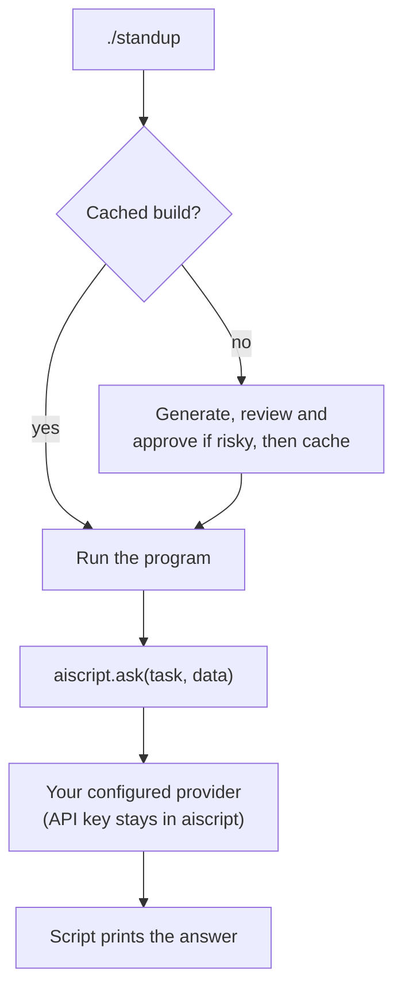

# aiscript

[](https://pypi.org/project/aiscript/)
[](https://pypi.org/project/aiscript/)

Write scripts in plain English and run them directly. `aiscript` generates and reviews a shell
or Python program from your description, caches it, and runs it. Later runs reuse the cached build.

## Install

Requires Python 3.10+. Install using one of:

```sh
uv tool install aiscript
# or
pipx install aiscript
# or
pip install aiscript
```

To update to the latest version, use the same tool you installed with:

```sh
uv tool upgrade aiscript
# or
pipx upgrade aiscript
# or
pip install --upgrade aiscript
```

See [installation and PATH setup](docs/installation.md) for troubleshooting.

## Quickstart

Run `aiscript --init` to choose a provider and create a starter configuration at
`~/.config/aiscript/config.yaml`. On an interactive first run that needs script generation,
aiscript also offers this choice if there is no configuration yet. The menu checks for local
executables and environment keys; a detected item is not necessarily signed in or ready to use.
You can select an undetected provider and finish its setup afterwards.

Existing configuration and unattended runs do not show the menu. Non-interactive `--init`
creates the OpenAI starter configuration. See [configuration](#configuration) and the
[configuration reference](docs/configuration.md) for provider setup and API keys.

You can create a named command interactively:

```sh
aiscript sizes
# Describe what it should do when prompted, then pass arguments on later runs:
aiscript sizes ~/Downloads --top 5
```

## Executable prompt files

On Linux or macOS, save this plain-English script as `biggest` in a folder such as `~/Documents`:

```text
#!/usr/bin/env aiscript

List the 10 largest immediate subfolders of the directory given as the first argument. Show their sizes in human-readable form, largest first. Do not modify any files.
```

In that folder, make it executable and run it:

```sh
chmod +x biggest
./biggest ~/Downloads
```

The first run generates and reviews the program. Inspect it if approval is requested; later runs
reuse the cached build. See [prompt files](docs/prompt-files.md) for PATH setup, Windows,
arguments, caching and rebuilding.

## AI inside scripts

Generated scripts can ask your configured model to summarise, classify or extract data through
`aiscript.ask` (Python) or `aiscript --ask` (shell). Their input is sent to the selected provider
on every run. A status line on stderr reports the configured timeout when a request starts; the
answer remains on stdout or is returned to the Python caller. API timeouts apply per attempt, so
retries can take longer. ACP timeouts are total request deadlines. See
[usage](docs/usage.md#ai-inside-scripts) and [privacy](docs/safety.md#privacy).

For example, save this as `standup`. Git can list commits but can't summarise them, so the prompt
asks for that step explicitly:

```text
#!/usr/bin/env aiscript

Print a short standup note for the git repository in the current directory. Collect my commits
from the last 24 hours (by the configured git user, all branches), then use AI to summarise them
into "Done" and "Next" bullet points, at most 5 bullets in total. If there are no commits, say so
without calling AI. Do not modify the repository.
```

```sh
chmod +x standup
cd ~/projects/my-app && ~/Documents/standup
```

The generated program runs `git log` itself and hands only that output to the model through
`aiscript.ask`. Only the commit data is sent to your provider, and only when the script runs.

Another example: save this as `explain-error` to get a plain-language diagnosis of any failing
command:

```text
#!/usr/bin/env aiscript

Run the command given as the arguments and capture its output and exit code. If it succeeds, print
its output unchanged and exit 0. If it fails, print its output, then use AI to explain the likely
cause in one short paragraph and suggest one concrete fix. Exit with the command's exit code. Do
not modify any files.
```

```sh
chmod +x explain-error
./explain-error npm run build
```

Only the failing command's output is sent to your provider, so avoid running it on commands that
print secrets.

### How it works



Generation and review happen once. Every later run skips straight to the cached program, and only
the `ask` call talks to the model.

## Safety review / decision models

Generated programs are checked before they are saved or run. Risky programs need approval; review
failures and unavailable reviewers also require approval. Review is not a sandbox. The reviewer can be a hosted or local decision model, including the
optional local GPU model QSIV (`aiscript[qsiv]`). See
[safety review](docs/safety.md) for the full behavior.

## Configuration

Set `default_provider` in `config.yaml` to choose the provider that writes your scripts and
answers AI calls inside them. The starter config (`aiscript --init`) has an entry for each choice.

- **APIs:** `openai` (or any OpenAI-compatible endpoint), `anthropic` and `gemini`. Put the API key
  and model in the config.
- **Installed agents (ACP):** `codex-acp`, `claude-acp`, `gemini-acp`, `opencode-go-acp` and
  `glm-acp` use the agent you already have installed and signed in to, with no `providers:` entry.
  The agent chooses its model. OpenCode Go needs `"model": "opencode-go/<model>"` in your OpenCode
  config. Agents are trusted local programs, not a sandbox. Install and sign in to the agent
  first: see [installing ACP agents](docs/configuration.md#installing-acp-agents).

```yaml
default_provider: claude-acp
```

See the [configuration reference](docs/configuration.md) for API keys, ACP limits, the optional
safety reviewer and environment variables, and [safety](docs/safety.md#acp-agents) for agent trust.

## Usage

Run `aiscript --help` for available commands. See [usage and storage](docs/usage.md) for command
management, Python dependencies and cache locations.

## Development

```sh
uv sync                      # install dependencies
uv run task test             # tests
uv run task dev --init       # try your checkout with a private, gitignored config in .dev/
```

Edit `.dev/config.yaml` to add an API key, then run any command with `uv run task dev` (for
example `uv run task dev sizes ~/Downloads`). See [development](docs/development.md).

## Docs

- [Installation](docs/installation.md)
- [Executable prompt files](docs/prompt-files.md)
- [Configuration reference](docs/configuration.md)
- [Safety review](docs/safety.md)
- [Usage and storage](docs/usage.md)
- [Development](docs/development.md)
