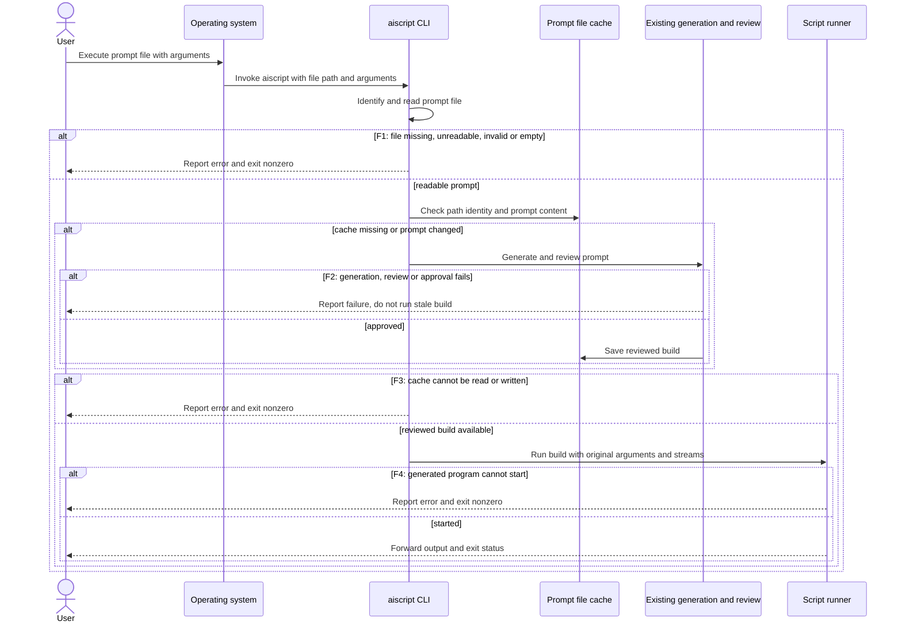
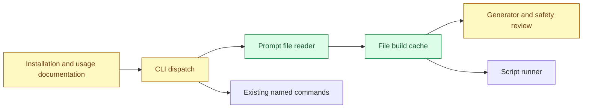

# Executable prompt scripts — design

- **Status:** Design approved in chat, 2026-11-09. Both Mermaid diagrams validated with the pinned Mermaid CLI.
- **Spec:** `specs/shebang-scripts/SPEC.md`, after design approval.

## User interface

```text
#!/usr/bin/env aiscript
List the largest folders inside the directory given as the first argument.
```

Save this as `biggest`, make it executable with `chmod +x biggest`, then run
`./biggest ~/Downloads`. Also support `aiscript ./biggest ~/Downloads`.
The shebang requires `aiscript` on `PATH`; an absolute interpreter path is an alternative.
Neither `$HOME` nor `~` is expanded by the operating system in the shebang.

## Main flow



## Components



## Proposed behavior and boundaries

- An explicit path selects file mode, preserving ordinary named-command behavior. Define exact
  recognition rules, including missing paths and leading-dash filenames, in the specification.
- Read the file as text, omit a leading shebang from the prompt, and pass subsequent command-line
  arguments without interpreting them. Prompt files without a shebang may be invoked explicitly.
- Cache builds separately from named commands, keyed by a normalized source path and validated
  against prompt content. A changed prompt must be regenerated and reviewed before execution.
  Define symlink, moved-file and concurrency behavior in the specification.
- Reuse existing static and configured model review, including rejection of risky builds when
  approval cannot be obtained. Report diagnostics on stderr and return the program's exit code.
- Do not modify shell profiles during package installation. The Python console entry point already
  creates `aiscript`; the installer chooses its location. Document checking `command -v aiscript`,
  making the installer-managed bin directory available on `PATH`, and restarting the shell if needed.
  Installer-specific guidance should be verified before writing it. Post-install messages are not
  assumed to be available across pip, pipx and uv.
- Shebang execution is a Unix-like operating system feature. Direct file invocation can be
  specified separately for Windows, without claiming that Windows supports Unix shebang execution.

## Questions for specification

- Exact file-mode syntax and behavior for ambiguous bare names.
- Cache identity, cleanup, concurrent builds, and whether changing only the shebang rebuilds.
- File encoding, size limits, error messages and failure exit statuses.
- Interaction of first-build approvals with redirected stdin and pipelines.
